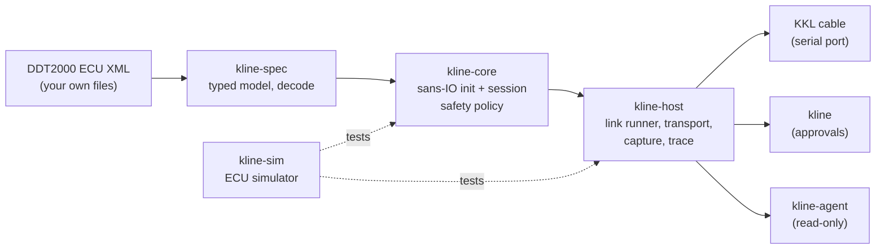

# kline architecture: crates, data flow and the sans-IO protocol core

This page explains how kline is put together: which crate does what, how a DDT2000 definition
becomes bytes on the K line, why the protocol core never touches a serial port, where the safety
policy sits, and how the simulator tests the whole chain without a car.

## Contents

- [Crate map](#crate-map)
- [Data flow: from XML to the K line](#data-flow-from-xml-to-the-k-line)
- [Sans-IO: actions and events](#sans-io-actions-and-events)
- [Where safety is enforced](#where-safety-is-enforced)
- [Two binaries, one approval feature](#two-binaries-one-approval-feature)
- [Testing end to end with the simulator](#testing-end-to-end-with-the-simulator)
- [no_std core](#no_std-core)

## Crate map

| Crate | Role | I/O |
|---|---|---|
| `kline-spec` | parses DDT2000 ECU XML into a typed model (`EcuDef`, requests, data items, `<K>` line settings, failures, AutoIdent) and decodes/encodes data | none: pure functions on bytes |
| `kline-core` | the K-line protocol: 5-baud and fast init, ISO 9141 and KWP2000 framing, echo handling, timing, sessions, retries, read-only scan, and the safety policy | none: sans-IO state machines, `no_std` + `alloc` |
| `kline-host` | the runtime both binaries share: the serial transport for the KKL cable, the simulator pty transport, a high-resolution timer, the link runner, capture, `--trace`, ECU definition loading and the read commands | serial port, files, clock |
| `kline-cli` | the interactive `kline` binary: everything in `kline-host` plus `exec`, `clear-dtc` and `scan`, and the terminal prompt for approvals | terminal |
| `kline-agent` | the read-only `kline-agent` binary: reads plus `prepare`, always JSON | none beyond `kline-host` |
| `kline-sim` | an ECU simulator: a virtual K line with echo and wake-up detection, ECUs that answer from a definition, replay of captures | in-process or a pty |
| `kline-bridge` | the Clio Link bridge logic for the ESP32-C3: profiles, scheduler, BLE GATT codec, BLE roles on top of the kline-core policy, lock-when-moving, fob output ([bridge-protocol.md](bridge-protocol.md)) | none: sans-IO, `no_std` + `alloc`; the firmware in `firmware/esp32c3/` and the host tests drive it |

Dependencies point one way: `kline-spec` <- `kline-core` <- `kline-host` <- `kline-cli` /
`kline-agent`. `kline-sim` depends on `kline-core` and `kline-spec` and is only a
dev-dependency of the others. `kline-bridge` depends on `kline-core` only (without its
`approved-routines` unless its own `approvals` feature is asked for); `kline-host` uses it,
without default features, for `--transport ble`.

## Data flow: from XML to the K line

Take `kline live --ecu sirius --frames 21A9`:

1. **Definition.** `kline-host` (`defs`) finds the Sirius 32 XML in your definitions directory
   and `kline-spec` parses it into an `EcuDef`: the ECU address, the `<K>` section (protocol,
   key bytes, timing attributes) and every request with its data items.
2. **Link configuration.** With its `spec` feature, `kline-core` turns the `<K>` section into a
   `LinkConfig`: protocol (ISO8, KWP 5-baud, KWP fast init), address and `KTiming`, filling in
   DDT2000's class defaults where the XML is silent (`spec::k_timing`). It also builds the
   `DefinitionGuard` that tells the safety policy whether this is a BMT/UCH/decoder and which
   requests have immobilizer-like names.
3. **Init.** `kline-host` (`link`) runs `FiveBaudInit` or `FastInit` for each variant in turn
   until one succeeds, executing every action on the transport with real time.
4. **Session.** The `InitOutcome` becomes a `Session`. Each read goes through
   `Session::request`, which asks the safety policy, builds the frame, and produces the actions
   for one exchange (flush, write, read echo, read reply, handle `7F .. 78`).
5. **Decode.** The reply payload goes back to `kline-spec`, which checks it
   (`decode_checked`: SID, negative reply, MinBytes, identifier echo) and decodes each data
   item with its scaling, unit or list.
6. **Output.** `kline-host` prints text or JSON lines, and writes every TX and RX to the JSONL
   capture.

## Sans-IO: actions and events

`kline-core` contains no serial port code and never reads a clock. Each state machine
(`FiveBaudInit`, `FastInit`, `Session`) hands out one `Action` at a time and waits for exactly one
`Event` in return:

| Action | Expected event |
|---|---|
| `SetDtr(bool)`, `SetBreak(bool)`, `Sleep { ms }`, `FlushRx`, `Write { frame, inter_byte_ms }` | `Done` |
| `CheckBreakLoopback` | `BreakLoopbackSeen(bool)` |
| `Read { count, timeout_ms }` | `ReadOk(bytes)` with exactly `count` bytes, or `ReadTimeout(partial)` |

Any other event fails the machine (`UnexpectedEvent`). The current time is passed in as
`now_ms`.

Why build it this way:

- **Deterministic tests.** A test can feed a machine a scripted list of events and check every
  action it emits, down to each 200 ms break bit (`tests/init_traces.rs`). Nothing depends on
  the speed of the computer running the test.
- **One protocol, many transports.** The same machines run over the FTDI cable
  (`kline-host::transport::KklLine`), the simulator's in-process virtual line, and the
  simulator's pty. A microcontroller driver could run them too.
- **Timing lives in one place.** Every wait is an explicit `Sleep` with a value that comes from
  the definition or from a named constant with a cited source ([protocol.md](protocol.md#timing-values-ktiming)).
  The host's job is only to sleep accurately, which `kline-host::hrtimer` does with an OS sleep
  plus a short busy-wait tail ([platforms.md](platforms.md#timing-precision)).

The full contract is in [protocol.md "Sans-IO contract"](protocol.md#sans-io-contract).

## Where safety is enforced

The policy is in `kline-core`, under the front ends, so no binary or library user can skip it.

- **Only the core builds frames.** `Action::Write` carries a crate-private `Frame` with no
  public constructor, and every request frame comes from a crate-private `Permit` issued by the
  policy. There is no way to hand the core arbitrary bytes to write.
- **Decisions use exact bytes and the real target.** The tier is decided on the exact payload
  and on the address the init actually woke, not on what the definition claims. The loaded
  definition's `DefinitionGuard` can only add refusals.
- **Default deny.** Tier 0 is an allowlist of documented reads. Everything else needs an
  approval, and the immobilizer class is refused in every tier.
- **No copying.** `Session`, the init machines, `InitOutcome`, `Action` and `Frame` are not
  `Clone`, so an approval or a session cannot be duplicated. Compile-fail doctests pin this.

The rules: [SAFETY.md](SAFETY.md). The bytes: [protocol.md "Safety policy"](protocol.md#safety-policy).

## Two binaries, one approval feature

Approvals (Tier 1-3) only exist when `kline-core` is built with the cargo feature
`approved-routines`. Without it, the approval types and challenge methods are not compiled at
all.

- `kline-cli` is the only crate that enables the feature. It reads the confirmation code from
  the terminal (`/dev/tty`, or `CONIN$` on Windows), never from stdin, and refuses with `--json`.
- `kline-host` and `kline-agent` depend on `kline-core` without it. `kline-agent` can only
  `prepare` a request: print its `RiskInfo` and the exact `kline exec` command for a human.
- Because cargo unifies features within one build, `kline-agent` checks at startup whether
  approvals were compiled in and refuses to run if so (exit 7). A test runs `cargo tree` and
  fails if the feature or `kline-cli` ever appears in `kline-agent`'s dependency tree.

Details: [cli.md](cli.md#building-kline-and-kline-agent).

## Testing end to end with the simulator

`kline-sim` plays the ECU. It models the KKL cable (echo of every TX byte, break looped back to
RX, a `00` residue byte), detects 5-baud and fast-init wake-ups from break edges, checks the
tester's timing against ISO windows in strict mode, and answers requests from a DDT2000
definition and a scenario of values.

- **In-process** (`kline_sim::line::VirtualLine`, all operating systems): a virtual millisecond
  clock, so a 2 second 5-baud init costs no real time. `kline-cli`'s `tests/e2e.rs` runs every
  command this way, including `exec` approvals.
- **Over a pty** (`kline_sim::pty::PtySim`, Linux and macOS): the real serial code path talks to
  a pseudo-terminal, with break and DTR carried over a control socket because a pty cannot
  represent them.
- **Replay** (`kline_sim::replay::ReplayEcu`): a capture from a session is played back as the
  ECU, and `kline replay` must decode the same values.
- **ECU write log.** The simulator classifies every request on its own, independently of
  `kline-core`, and logs anything that is not a read. Tests assert that log is empty where it
  should be, a second safety check behind the core's allowlist.

What this can and cannot prove is spelled out in [sim.md](sim.md#what-the-simulator-proves-and-what-it-cannot).
The short version: the simulator shares the core's assumptions about the real ECUs, so only a
test on the car can confirm them.

## no_std core

`kline-core` is `#![no_std]` with `alloc` when built without default features, and
`#![forbid(unsafe_code)]`. The `std` feature (default) adds standard error traits; the `spec`
feature adds the mapping from `kline-spec` definitions (which needs `std`). A test
(`tests/no_std_build.rs`) builds it with `--no-default-features` and checks that `kline-spec`
is not pulled in. Running the core on a microcontroller is possible in principle; it has not
been tried.
