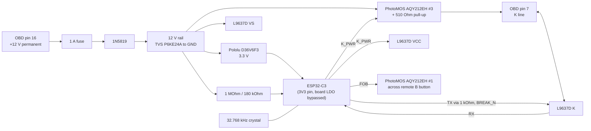

# Clio Link bridge hardware: ESP32-C3, L9637D and the fob output

The bridge sits behind the dashboard on the OBD socket (through a Y-splitter, so the KKL cable
still fits), talks K line to the Sirius and the BMT, and Bluetooth LE to the phone and the Mac.
This page is the wiring: pinout, schematic, parts (checked against the MASTER-PLAN-v2 shopping
list), power budget, the bench test and the car bring-up checklist. The protocol is in
[bridge-protocol.md](bridge-protocol.md); the firmware skeleton is `firmware/esp32c3/`.

**Nothing on this page has been built or measured yet.** Values marked *estimate* are from
datasheets or the plan, not from this board.

## Contents

- [Block diagram](#block-diagram)
- [Pinout](#pinout)
- [Schematic](#schematic)
- [Parts](#parts)
- [Power budget](#power-budget)
- [Firmware build](#firmware-build)
- [Bench test](#bench-test)
- [Car bring-up checklist](#car-bring-up-checklist)
- [Not verified](#not-verified)

## Block diagram



## Pinout

ESP32-C3 (DevKitM-1 on the bench, SuperMini in the car; both expose GPIO0/1). Strapping pins
GPIO2, GPIO8 and GPIO9 are left alone; GPIO21 (U0TXD) carries the ROM boot log and is
therefore never used for an output that moves anything.

| GPIO | Name | Direction | Connects to | Why this pin |
|---|---|---|---|---|
| 0 | XTAL_32K_P | analog | 32.768 kHz crystal + 18 pF C0G to GND | the C3's only 32 kHz crystal pins; needed for BLE light sleep in the uA range (PLAN-RESEARCH B1) |
| 1 | XTAL_32K_N | analog | crystal + 18 pF C0G to GND | same |
| 2 | (strapping) | | not connected | boot mode strap |
| 3 | VBAT | ADC1_CH3 in | divider 1 MOhm (rail) / 180 kOhm (GND), 100 nF at the pin | ADC1 channel; 15 V -> 2.29 V (PLAN-RESEARCH B5) |
| 4 | K_RX | UART1 RX in | L9637D RX (pin 1) | free, not strapping; RX of L9637D has its own pull-up to VCC |
| 5 | K_TX | UART1 TX out | 1 kOhm -> TX node -> L9637D TX (pin 4) | free, not strapping |
| 6 | K_PWR | out, low at boot | L9637D VCC (pin 3, 100 nF to GND) and 330 Ohm -> AQY212EH #3 LED (pull-up switch); **10 kOhm pull-down to GND** | one pin powers the transceiver and the K pull-up together; low = K released, transceiver unpowered (< 1 uA, PLAN-RESEARCH B2) |
| 7 | FOB | out, low at boot | 330 Ohm -> AQY212EH #1 LED; **10 kOhm pull-down to GND** | the pull-down keeps the PhotoMOS off while the pin floats during reset (MASTER-PLAN-v2 3.1 rule 3) |
| 8 | (strapping) | | not connected (onboard LED on some boards) | |
| 9 | (strapping) | | BOOT button only | |
| 10 | BREAK_N | open-drain out, high (released) at boot | TX node | pulls the L9637D TX input low for the 5-baud bits while UART1 stays configured |
| 18, 19 | USB D-/D+ | | USB-Serial-JTAG | flashing and console |
| 20 | (spare) | | free | input at boot; the only spare pin safe for one more output (e.g. one CPE button line) |
| 21 | (U0TXD) | | free, never an actuator | toggles during the ROM boot log |

TX node: UART1 TX through 1 kOhm, BREAK_N directly, 10 kOhm pull-up to the L9637D VCC (so the
input never floats low while the transceiver is powered), L9637D TX. With BREAK_N low the node
is low (UART TX high only pushes 3.3 mA through the 1 kOhm). kline-core's `SetBreak` therefore
maps to BREAK_N, and its 200 ms `Sleep`s bit-bang the 5-baud address byte
(`firmware/esp32c3/src/main.rs`).

**Not enough pins for CPE button emulation** (MASTER-PLAN-v2 3.1, two outputs for lock and
unlock): only GPIO20 is left. If the owner chooses that path, it needs an I/O expander or a
board with more pins; GPIO21 must not be used (boot log).

## Schematic

```text
OBD16 +12V --[F1 1 A]--+--[D1 1N5819]--+-- RAIL12
                                       |
                                       +--[TVS1 P6KE24A]-- GND
                                       +--[C1 100 uF/35 V]-- GND
                                       +--[C2 100 nF]-- GND
                                       +-- U1 D36V6F3 VIN ; U1 GND -- GND ; U1 VOUT -- 3V3
                                       +-- U2 L9637D VS (pin 7), [C3 100 nF] to GND
                                       +-- R1 1 MOhm --+-- GPIO3 ; R2 180 kOhm to GND ; C4 100 nF to GND
                                       +-- K1 AQY212EH #3 output A ; output B --[R3 510 Ohm 0.6 W]-- KNODE

3V3 -- ESP32-C3 3V3 pin, [C5 10 uF] + [C6 100 nF] to GND (board power LED removed)

GPIO6 K_PWR --+-- U2 VCC (pin 3), [C7 100 nF] to GND
              +--[R4 330 Ohm]-- K1 LED anode ; K1 LED cathode -- GND
              +--[R10 10 kOhm]-- GND   (transceiver and pull-up off while the pin floats)

KNODE = OBD7 (K) --[TVS2 P6KE24A, to GND, near the connector]
KNODE -- U2 K (pin 6)
U2 RX (pin 1) -- GPIO4
GPIO5 --[R5 1 kOhm]--+-- TXNODE -- U2 TX (pin 4)
GPIO10 (open drain) -+
TXNODE --[R6 10 kOhm]-- U2 VCC
U2 GND (pin 5) -- GND ; U2 LI (pin 8) --[R7 10 kOhm]-- RAIL12 ; U2 LO (pin 2) not connected

GPIO7 FOB --[R8 330 Ohm]-- K2 AQY212EH #1 LED anode ; LED cathode -- GND
GPIO7 --[R9 10 kOhm]-- GND
K2 outputs A/B -- across the button pads of remote B (polarity free)
Remote B powered by its own CR2032 (or 3V3 through a series 1N5819, ~2.9 V)

GPIO0 --[X1 32.768 kHz]-- GPIO1 ; C8 18 pF GPIO0 to GND ; C9 18 pF GPIO1 to GND
OBD4, OBD5 -- GND
```

Pin numbers of the L9637D (SO-8) are from PLAN-RESEARCH B2; check them against the ST
datasheet before soldering. The plan's research proposed a P-FET high-side switch for VS and
the pull-up; this design follows the MASTER-PLAN-v2 shopping list instead (item 27: one
PhotoMOS for the K pull-up) and keeps VS on the rail, where the L9637D draws < 1 uA with VCC
off (PLAN-RESEARCH B2, NOT VERIFIED on this board).

## Parts

Cross-checked with MASTER-PLAN-v2 section 5.2 (items 20 to 41). Everything the schematic
needs is on that list; nothing extra has to be bought.

| Ref | Part | Shopping list item | Note |
|---|---|---|---|
| ESP32-C3 | ESP32-C3-DevKitM-1 (bench), SuperMini (car) | 20, 21 | not XIAO: GPIO0/1 not exposed (list note, NOT VERIFIED) |
| X1, C8, C9 | 32.768 kHz crystal, CL 12.5 pF; 2 x 18 pF C0G | 22, 23 | 18 pF is close to 2 x (12.5 - ~2.5 pF stray) |
| U2 | L9637D | 24, 25 (SO-8 to DIP adapter) | |
| U1 | Pololu D36V6F3 | 26 | quiescent < 0.1 mA |
| K1, K2 | AQY212EH | 27 | K2 fob, K1 K pull-up; 2 spare (CPE lock/unlock or remote B board) |
| R1..R10 | 1 MOhm, 180 kOhm, 330 Ohm x 2, 1 kOhm, 10 kOhm x 4 | 28 (kit: 22, 330, 1k, 10k, 180k, 1M) | |
| R3 | 510 Ohm 0.6 W | 29 | 14.4 V / 510 Ohm = 28 mA, 0.41 W while K is held low |
| C1..C9 | 100 uF/35 V, 10 uF, 100 nF x 5 | 30 | |
| TVS1, TVS2 | P6KE24A | 31 | |
| D1 | 1N5819 | 32 | reverse polarity |
| F1 | inline blade fuse holder, 1 A | 33 | |
| | OBD Y-splitter, male pigtail, female socket | 34, 35, 36 | female socket: bench, KKL cable against the bridge |
| | perfboard, headers, terminal blocks, wire, 12 V supply, enclosure | 37 to 41 | |

## Power budget

| Consumer | Active (session, BLE connected) | Asleep (BLE advertising, light sleep) |
|---|---|---|
| ESP32-C3 | ~20 to 30 mA *estimate* (CPU busy-waits on UART reads in the skeleton) | 0.2 to 0.5 mA *estimate*, decision limit 1.0 mA (MASTER-PLAN-v2 G14) |
| D36V6F3 quiescent | included in conversion loss (~85 %) | < 0.1 mA (datasheet) |
| L9637D | ~1.4 mA VCC (PLAN-RESEARCH B2) | < 1 uA (VCC off) |
| K pull-up 510 Ohm | ~28 mA only while K is low (about 40 % of the time while polling) | 0 (PhotoMOS off) |
| AQY212EH LED (K1) | ~6 mA | 0 |
| Divider | 12 uA | 12 uA |
| Fob PhotoMOS | 6 mA only during a 300 ms pulse | 0 |
| **Total from 12 V** | ~25 to 35 mA *estimate* | **~0.3 to 0.7 mA** *estimate*, budget 2 mA (MASTER-PLAN-v2 M8) |

At 0.5 mA asleep the bridge takes 12 mAh a day, about 0.36 Ah a month, under 1 % of the 52 Ah
battery (PLAN-RESEARCH B8). The K-line pull-up leakage with the ignition off (G15) is the one
unknown that could dominate; that is why the pull-up is switched.

## Firmware build

```sh
rustup target add riscv32imc-unknown-none-elf
cd firmware/esp32c3
cargo build --release                  # the bridge, no BLE yet (W7)
cargo build --release --features bench # + drive profile at boot, live samples on USB serial
espflash flash --monitor --chip esp32c3 target/riscv32imc-unknown-none-elf/release/clio-link-esp32c3
```

Built here on 2026-11-23 with esp-hal 1.2.2 (debug and `--release --features bench`); not
flashed. The firmware is not a workspace member (`exclude = ["firmware"]`). What the skeleton
does and does not do is at the top of `src/main.rs`; BLE (NimBLE via esp-idf, or esp-radio +
TrouBLE), light sleep with the 32 kHz crystal and NVS are W7. kline-core's approvals do not
build without `std` yet ([bridge-protocol.md](bridge-protocol.md#kline-core-changes-needed)), so
the firmware is Tier 0 only for now.

## Bench test

Power from the 12 V bench supply through the fuse; no car, no ECU.

1. **Supply.** Current at 12.0 V with the C3 erased: below 1 mA. Flash; current running: note
   it.
2. **Boot safety of the fob output.** Scope or logic analyzer on GPIO7 and on the PhotoMOS
   output (ohmmeter). Power-cycle 20 times, press reset 20 times, flash once: the output never
   closes. Then let the watchdog fire (a debug build that hangs in a step): still never closes.
3. **K line released at boot.** Pull K up to 12 V through 510 Ohm on the bench (a second
   510 Ohm to the supply): K stays at 12 V through power-up and reset, also with GPIO6
   floating.
4. **5-baud waveform.** `--features bench` build, K pulled up as in 3, nothing else on K. On
   the scope: 300 ms idle, then 0x7A as 10 bits of 200 ms (start low, bits LSB first
   0,1,0,1,1,1,1,0, stop high), each edge within +-10 ms of the 200 ms grid (ISO 9141-2, as
   kline-sim's strict mode checks). The init then fails with no keywords (no ECU): expected.
5. **UART level.** Connect the KKL cable to the same K node through the female OBD socket and
   watch the bridge's frames with a serial terminal at 10400 on the Mac: the bytes match the
   Raw notifications (once BLE exists) or the bench console.
6. **Fob pulse.** Remote B on the PhotoMOS, a LOCK command (W7) or a debug build that pulses
   once: one press, 300 ms, then nothing for 5 s.
7. **Sleep current** (W7): advertising only, 32 kHz crystal fitted, below 1.0 mA; else the
   nRF52840 fallback (MASTER-PLAN-v2 G14, item 67).

A simulator-backed bench test (the bridge against kline-sim through the KKL cable) needs an
ECU-side serial mode in kline-sim that does not exist yet.

## Car bring-up checklist

Read-only first (MASTER-PLAN-v2 M8). Every step gets a line in the session log.

- [ ] Battery at rest 12.4 V or more (P6); one tool on the cable (P7): KKL cable unplugged
      while the bridge has the line, or the bridge yielded.
- [ ] OBD pin 16 is permanent +12 V with the ignition off (G16), pin 4/5 ground.
- [ ] Bridge plugged in through the Y-splitter, cable tied, no strain on the socket.
- [ ] Quiescent current with the bridge asleep, ignition off: extra draw below 2 mA (M8).
      Measure once with K_PWR forced on to see the pull-up leakage into the unpowered Sirius
      (G15).
- [ ] Ignition on, `--features bench` build: the Sirius init gives `55 D0 8F` and `~addr 85`
      (as the KKL cable did on 2026-11-22); live samples arrive; values match a `kline live`
      capture of the same minute (rpm, coolant, battery).
- [ ] Engine start with the bridge connected: it re-initialises after the voltage dip (G17).
- [ ] Ignition cycle: the bridge stops, sleeps, and comes back.
- [ ] `YIELD_KLINE`, then the KKL cable works; `RESUME_KLINE` takes the line back.
- [ ] 30 minutes of driving without a dropout (M8).
- [ ] Below 12.0 V (bench supply on the OBD pigtail, not the car): the bridge stops and sleeps.
- [ ] No LOCK/UNLOCK and no lock-when-moving until G4 (inner handles open locked doors), G5
      (CPE levels) and G6 (lock bit) are answered and the owner decided (MASTER-PLAN-v2 M11).

## Not verified

- Every electrical value on this page; the L9637D pin numbers; GPIO drive of L9637D VCC plus
  one PhotoMOS LED from one pin (~8 mA); the 1 kOhm / open-drain BREAK_N wired-AND.
- Whether the C3's UART RX reports the break as framing errors or bytes (used for the break
  loopback check; kline-core only warns when it is missing).
- That the SuperMini exposes GPIO0/1 and that its LDO can be bypassed.
- The ADC scale (nominal 0..2500 mV at 11 dB): calibrate against the multimeter.
